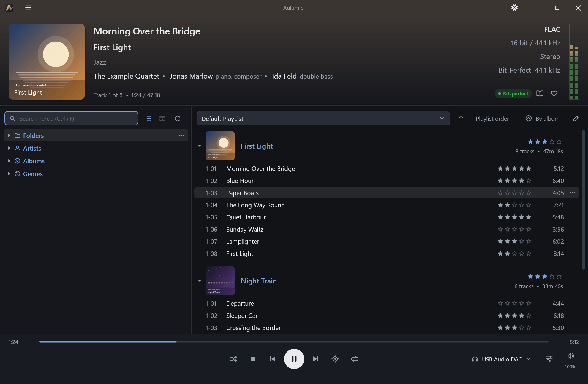
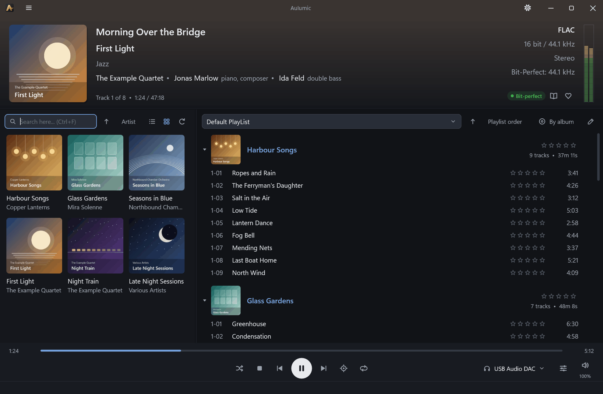

# Aulumic

**A bit-perfect music player for Windows.** Aulumic sends your music straight to your DAC, over WASAPI exclusive mode or your DAC's ASIO driver. Out of the box nothing is touched: resampling is off, DSD goes out as DSD, and the only thing in the way is the volume control.



Aulumic is one program file, `AulumicNS.exe` (NS stands for Native Sound). It needs no installation and no extra DLLs: the decoders (FLAC, Apple Lossless), the resampler, the loudness meter and the whole user interface are part of the program.

## What it does

**Playback**
- WASAPI exclusive mode and ASIO, with a badge and a Signal Path window that show whether the output is bit-perfect, and every stage between the file and the DAC when it isn't.
- FLAC, WAV, AIFF, Apple Lossless (ALAC), DSF and DFF. DSD as native DSD over ASIO, as DoP, or converted to PCM.
- Files with more than two channels (5.1, for example) play as a stereo mix.
- Gapless playback, and Stop after current track.
- A resampler you can leave off, or set up in detail (quality, phase, bandwidth, anti-aliasing).
- ReplayGain (EBU R128) with a built-in scanner, and automatic headroom against clipping.
- A five-band tone control that shows its curve.

**Library and playlists**
- A library of your music folders with a tree (folders, artists, composers, albums, genres), search and virtual folders. Local folders are watched for changes.
- For classical music: the movements of a work under a heading of their own, and browsing by composer.
- Album tiles: the albums of any part of the library as covers, next to the tree. A tile plays, drags and opens its menu like an album in the tree.
- Playlists and auto-playlists with a query builder, M3U import and export, ratings and favourites.
- A tag editor, a check of the tags for things that don't agree, a cover viewer, a booklet viewer for PDF booklets and artist information.

**Look and feel**
- Dark and light theme (or follow Windows), six accent colours, sharp at every Windows scaling, touch scrolling.
- A complete help inside the program (F1).



## Sound quality

Bit-perfect playback is the default, and the program shows when it isn't: the badge says Bit-perfect or Processed, and the Signal Path lists every stage that touches the audio.

- **Lossless means identical:** The built-in decoders are tested to give exactly the samples that were stored. Apple Lossless and AIFF files are checked against the same audio as FLAC and WAV, bit for bit.
- **One calculation, one rounding:** Whatever changes the audio (volume, ReplayGain, tone control, resampler) is calculated in 64-bit floating point and rounded once, at the very end, with dither. A 16-bit file is never rounded back to 16 bits on the way.
- **The resampler:** Own code, with a choice of linear, intermediate and minimum phase. Measured with test tones, what it adds stays below -150 dB at 24-bit precision and below -200 dB at the highest setting. Against libsoxr, a widely used resampler, the output agrees to within 0.001 dB in level.
- **DSD:** Sent to the DAC unchanged, as native DSD or DoP. Converted to PCM only on request.
- **No clipping:** With automatic headroom, an album whose peaks would not fit after resampling is lowered by exactly what it needs. Nothing is clipped and nothing is limited.

## What it doesn't do

Aulumic does one thing: it plays your own lossless music files, unchanged, on Windows. Some things are left out on purpose, others follow from how the program is built.

- **Lossy formats (MP3, AAC, Ogg Vorbis, Opus):** not played. Aulumic uses no external DLLs, so every format needs its own decoder inside the program, and the work went into the lossless ones. An M4A file with AAC inside is refused with a message.
- **Other lossless formats (APE, WavPack) and CUE sheets:** not at present.
- **SACD ISO images:** not played. DSD plays from DSF and DFF files.
- **Streaming services (Qobuz, Tidal, Spotify) and internet radio:** no. The services only open their catalogues to programs with a contract, and Aulumic plays files, not streams.
- **Network playback (UPnP / DLNA) and remote control apps:** no. The music has to be in folders the PC can reach; a network share or NAS is fine.
- **Multichannel output:** no. Files with more than two channels play as a stereo mix.
- **Shared mode and plugins:** Aulumic takes the audio device exclusively, which is what makes bit-perfect playback possible, so other programs are silent on that device while it plays. There are no VST plugins and no room correction.
- **Linux and macOS:** Windows 10 and 11 only. The output and the whole user interface are built on Windows itself.

Wishes are welcome under **Discussions**; the Support section below says what to expect.

## Download

Take `AulumicNS-<version>-win64.zip` from the **Releases** page of this repository, unpack it into a folder of your choice and start `AulumicNS.exe`.

- Windows 10 or 11, 64 bit.
- The program isn't signed, so Windows SmartScreen may warn the first time: choose "More info", then "Run anyway".
- Aulumic is portable: it keeps its settings and library in the folders `Data` and `Cache` next to the program file. If it can't write there, it uses `%APPDATA%\AulumicNS`.
- To remove it, delete the folder.

**New versions:** Aulumic can check for itself: Main menu > About > Check for updates, or at every start when that is switched on in Preferences > System > Internet. To get an email from GitHub whenever a new version is released, sign in to GitHub, open this repository and choose **Watch > Custom > Releases**. Without a GitHub account, the releases can be followed in a feed reader at `https://github.com/AndyLubke/AulumicNS/releases.atom`.

## First steps

1. **Add your music:** Main menu > Preferences > Library > Add folder.
2. **Choose the output:** click the device name at the bottom right of the main window and pick your DAC. WASAPI devices and ASIO drivers share one list.
3. **Play:** double-click an album or a track.

Press F1 for the help.

### Artist biographies

Artist Info shows the introduction of the artist's Wikipedia article, without any set-up. With a personal Last.fm API key the text comes from Last.fm, which knows more artists. A key is free: create an API account at [last.fm/api](https://www.last.fm/api) and paste the key into Preferences > System > Internet.

## Support

Aulumic is a hobby project of a retired developer, shared as it is. There's no support, and no promise of fixes or new features. That's also why the issue tracker of this repository is switched off.

Remarks and experiences are welcome under **Discussions**. They're read, but may go unanswered.

The help inside the program (F1) explains every window and setting, and has a chapter on solving problems. And you're free to change the program yourself: that's what the licence is for.

## Building from source

You need [Lazarus](https://www.lazarus-ide.org/) 4.8 with Free Pascal 3.2.2, 64 bit. The only package used is the LCL, which comes with Lazarus.

```
lazbuild --build-mode=Release AulumicNS.lpi
```

The program is written to `bin\Release\AulumicNS.exe`. Use `--build-mode=Debug` for a build with range checks and a memory leak report (`heaptrc.log`). You can also open `AulumicNS.lpi` in Lazarus and press F9.

The tests (FPCUnit, nothing is played on a device):

```
lazbuild Tests\AulumicNSTests.lpi
Tests\lib\x86_64-win64\AulumicNSTests.exe --all --format=plain
```

## What is where

| Folder | Content |
|---|---|
| `src\gui` | The user interface library: controls, lists, menus, theme and vector icons, drawn with Direct2D and DirectWrite |
| `src\app` | The program: main window, dialogs, settings |
| `src\audio` | The engine: decoders, resampler, WASAPI and ASIO output, DSD, loudness |
| `src\library` | The music library: database, scanner, queries, folder watching |
| `src\tags` | AulumicTag: reading and writing tags (a fork of OvoTag) |
| `help` | The help text (Markdown) and its screenshots, built into the program |
| `Tests` | The test program |
| `Tools` | Development tools: an audio simulator, a library benchmark, check scripts |

All windows are built in code; there are no `.lfm` form files.

## How it was made

Aulumic is the work of André Lubke: built on his earlier, hand-written player of the same name, and developed further with the help of Claude Code (Anthropic's AI coding assistant).

## Licence

Copyright © 2026 André Lubke.

Aulumic is free software: you can redistribute it and/or modify it under the terms of the **GNU General Public License, version 3**, as published by the Free Software Foundation. It is distributed in the hope that it will be useful, but **without any warranty**; without even the implied warranty of merchantability or fitness for a particular purpose. See [LICENSE](LICENSE) for the full text.

Parts by others, and their licences, are listed in [THIRD-PARTY-NOTICES.md](THIRD-PARTY-NOTICES.md). In short:

- **AulumicTag** (`src\tags`) is a fork of OvoTag, Copyright © 2011 Marco Caselli, under a modified LGPL.
- **ASIO** is a trademark and software of Steinberg Media Technologies GmbH.
